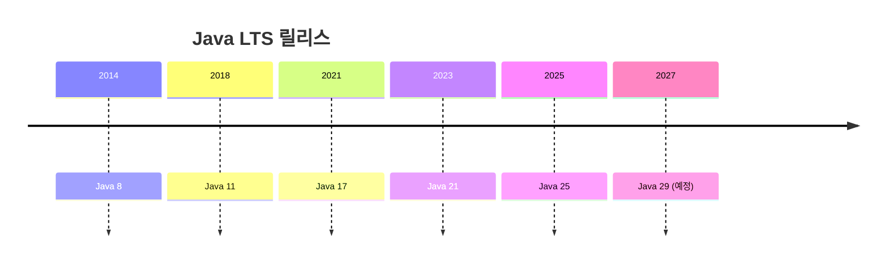
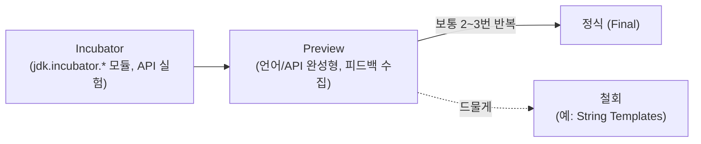
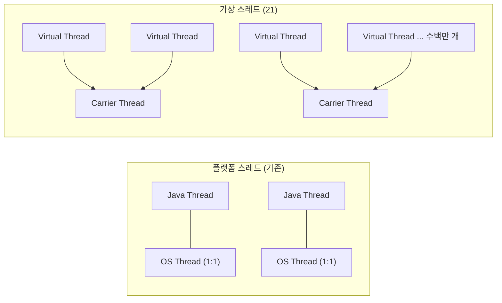

# JDK 버전별 핵심 업데이트 (Java 8 ~ 27)

> 기준일: 2026-10-25 (최신 GA: **JDK 27**, 최신 LTS: **JDK 25**)
> 이 프로젝트는 **Java 21** 을 사용한다.

---

## 0. 먼저 알아둘 것

### 릴리스 주기와 LTS

- **Java 9 까지**: 기능이 준비되면 출시 (몇 년 간격)
- **Java 10 부터**: **6개월마다** 정기 릴리스 (매년 3월, 9월)
- **LTS (Long-Term Support)**: 장기 지원 버전. Java 17 이후로는 **2년마다** (17 → 21 → 25 → 29 예정)
- LTS 가 아닌 버전은 다음 버전이 나오면 지원이 끝난다. **실무에서는 사실상 LTS 만 쓴다.**



### Preview / Incubator 란?

새 기능은 바로 확정되지 않고 몇 번의 시험 단계를 거친다.



- Preview 기능은 `--enable-preview` 옵션을 줘야 컴파일/실행된다.
- **시험/면접에서 "몇 버전 기능인가"는 보통 정식(Final) 버전을 기준으로 답한다.**

---

## 1. 한눈에 보는 요약표

| 버전 | 출시 | LTS | 핵심 키워드 |
|---|---|---|---|
| **8** | 2014-03 | ✅ | 람다, Stream, Optional, `java.time`, default 메서드 |
| 9 | 2017-09 | | 모듈 시스템(JPMS), JShell, `List.of()`, G1 기본 GC |
| 10 | 2018-03 | | `var` (지역 변수 타입 추론) |
| **11** | 2018-09 | ✅ | `HttpClient` 정식, `String` 메서드 추가, `java Hello.java` 실행 |
| 12 | 2019-03 | | switch 표현식(preview), Shenandoah GC |
| 13 | 2019-09 | | 텍스트 블록(preview) |
| 14 | 2020-03 | | **switch 표현식 정식**, 친절한 NPE 메시지 |
| 15 | 2020-09 | | **텍스트 블록 정식**, ZGC 정식, Nashorn 제거 |
| 16 | 2021-03 | | **record 정식**, **instanceof 패턴 매칭 정식**, `Stream.toList()` |
| **17** | 2021-09 | ✅ | **sealed 클래스 정식**, JDK 내부 API 강한 캡슐화 |
| 18 | 2022-03 | | 기본 인코딩 UTF-8, 간단한 웹 서버(`jwebserver`) |
| 19 | 2022-09 | | 가상 스레드(preview) |
| 20 | 2023-03 | | (preview 기능들의 반복) |
| **21** | 2023-09 | ✅ | **가상 스레드 정식**, **switch 패턴 매칭 정식**, record 패턴, Sequenced Collections |
| 22 | 2024-03 | | FFM API 정식, 이름 없는 변수 `_` 정식 |
| 23 | 2024-09 | | Markdown 주석(`///`), ZGC 세대별 모드 기본값 |
| 24 | 2025-03 | | Stream Gatherers 정식, 가상 스레드 pinning 해결, 양자 내성 암호 |
| **25** | 2025-09 | ✅ | `void main()` 간결한 소스 파일, 모듈 import, Scoped Values, Compact Object Headers |
| 26 | 2026-03 | | `HttpClient` HTTP/3, AOT 객체 캐싱(모든 GC), Applet API 제거 |
| 27 | 2026-09 | | G1 모든 환경 기본 GC, Compact Object Headers 기본값, TLS 1.3 양자 내성 키 교환 |

---

## 2. 같은 코드가 버전마다 어떻게 바뀌나

Java 의 언어 변화는 결국 **"데이터를 더 간결하고 안전하게 다루기"** 라는 한 방향으로 흐른다.
같은 문제를 버전별로 풀어보면 흐름이 잘 보인다.

**문제**: 도형(원, 사각형)의 넓이를 구하라.

### Java 8 — 클래스 + instanceof + 캐스팅

```java
interface Shape {}

final class Circle implements Shape {
    private final double radius;
    Circle(double radius) { this.radius = radius; }
    double getRadius() { return radius; }
    // equals, hashCode, toString 도 직접 작성해야 함...
}

final class Square implements Shape {
    private final double side;
    Square(double side) { this.side = side; }
    double getSide() { return side; }
}

static double area(Shape shape) {
    if (shape instanceof Circle) {
        Circle c = (Circle) shape;              // 확인하고 또 캐스팅
        return Math.PI * c.getRadius() * c.getRadius();
    } else if (shape instanceof Square) {
        Square s = (Square) shape;
        return s.getSide() * s.getSide();
    }
    throw new IllegalArgumentException("unknown shape"); // 새 도형이 추가되면? 런타임에야 알게 됨
}
```

### Java 16 — record + instanceof 패턴 매칭

```java
record Circle(double radius) implements Shape {}   // 생성자, getter, equals/hashCode/toString 자동
record Square(double side) implements Shape {}

static double area(Shape shape) {
    if (shape instanceof Circle c) {               // 검사 + 캐스팅 + 변수 선언을 한 번에
        return Math.PI * c.radius() * c.radius();
    } else if (shape instanceof Square s) {
        return s.side() * s.side();
    }
    throw new IllegalArgumentException("unknown shape");
}
```

### Java 21 — sealed + switch 패턴 매칭 + record 패턴

```java
sealed interface Shape permits Circle, Square {}   // 구현체를 Circle, Square 로 "봉인" (17 정식)
record Circle(double radius) implements Shape {}
record Square(double side) implements Shape {}

static double area(Shape shape) {
    return switch (shape) {
        case Circle(double r) -> Math.PI * r * r;  // record 를 바로 분해 (record 패턴)
        case Square(double s) -> s * s;
        // default 가 필요 없다! sealed 덕분에 컴파일러가 "모든 경우를 다 다뤘다"는 걸 안다.
        // Triangle 을 permits 에 추가하면 여기서 "컴파일 에러" 가 난다. → 런타임 버그가 컴파일 타임으로
    };
}
```

> 이 조합(**record + sealed + 패턴 매칭**)을 **데이터 지향 프로그래밍(Data-Oriented Programming)** 이라고 부른다.

---

## 3. LTS 버전 상세

### 3.1 Java 8 (2014) — 함수형 프로그래밍의 시작

자바 역사상 가장 큰 변화. 지금도 레거시 시스템에서 많이 쓰인다.

| 기능 | 설명 |
|---|---|
| **람다 표현식** | 익명 클래스를 `(a, b) -> a + b` 로 간결하게 |
| **함수형 인터페이스** | `Function`, `Supplier`, `Consumer`, `Predicate` 등 (`java.util.function`) |
| **Stream API** | 컬렉션을 선언적으로 처리 (`filter`, `map`, `collect`) |
| **Optional** | null 가능성을 타입으로 표현 |
| **`java.time`** | `LocalDate`, `LocalDateTime`, `ZonedDateTime` — 불변, 스레드 안전 (`Date`/`Calendar` 대체) |
| **default / static 메서드** | 인터페이스에 구현 메서드 추가 가능 → 하위 호환을 지키며 인터페이스 확장 |
| **메서드 참조** | `String::length`, `System.out::println` |
| **CompletableFuture** | 비동기 작업 조합 |
| **Metaspace** | PermGen 영역 제거 → 클래스 메타데이터를 네이티브 메모리에 저장 |

```java
// Java 7
List<String> result = new ArrayList<>();
for (String name : names) {
    if (name.length() > 3) {
        result.add(name.toUpperCase());
    }
}

// Java 8
List<String> result = names.stream()
        .filter(name -> name.length() > 3)
        .map(String::toUpperCase)
        .collect(Collectors.toList());
```

### 3.2 Java 11 (2018) — 8 이후 첫 LTS

9, 10 의 변화가 여기에 함께 포함된다.

| 버전 | 기능 | 설명 |
|---|---|---|
| 9 | **모듈 시스템 (JPMS)** | `module-info.java` 로 패키지 공개 범위 제어. JDK 자체도 모듈로 쪼개짐 |
| 9 | **컬렉션 팩토리** | `List.of(1, 2)`, `Set.of()`, `Map.of("a", 1)` — **불변** 컬렉션 |
| 9 | JShell | 자바 REPL |
| 9 | interface private 메서드 | default 메서드끼리 공통 코드 공유 |
| 9 | G1 GC 기본값 | Parallel GC → G1 |
| 10 | **`var`** | 지역 변수 타입 추론: `var list = new ArrayList<String>();` |
| 11 | **`HttpClient`** | `HttpURLConnection` 대체. HTTP/2, 비동기 지원 |
| 11 | **String 메서드** | `isBlank()`, `lines()`, `strip()`, `repeat(n)` |
| 11 | **Files 메서드** | `Files.readString()`, `Files.writeString()` |
| 11 | 단일 파일 실행 | `javac` 없이 `java Hello.java` |
| 11 | Java EE / CORBA 모듈 제거 | `javax.xml.bind`(JAXB) 등이 JDK 에서 빠짐 → 별도 의존성 필요 |

> ⚠️ **라이선스 변화**: Java 11 부터 Oracle JDK 는 상업적 사용 시 유료화(이후 17 에서 다시 무료 조건 완화).
> 이때부터 **OpenJDK 기반 배포판**(Eclipse Temurin, Amazon Corretto, Azul Zulu 등)이 널리 쓰이게 됐다.

```java
var client = HttpClient.newHttpClient();
var request = HttpRequest.newBuilder(URI.create("https://example.com")).build();
var response = client.send(request, HttpResponse.BodyHandlers.ofString());
```

### 3.3 Java 17 (2021) — 현대 자바의 기준선

**Spring Boot 3 / Spring Framework 6 의 최소 버전.** 12 ~ 16 의 기능이 대거 정식화됐다.

| 버전 | 기능 | 설명 |
|---|---|---|
| 14 | **switch 표현식** | `->` 문법, 값 반환, `yield`. break 누락 버그 방지 |
| 14 | **친절한 NPE** | `Cannot invoke "String.length()" because "user.name" is null` 처럼 원인 표시 |
| 15 | **텍스트 블록** | `"""` 로 여러 줄 문자열 (SQL, JSON 작성이 편해짐) |
| 15 | ZGC, Shenandoah 정식 | 일시 정지 시간이 매우 짧은 GC |
| 16 | **record** | 불변 데이터 클래스. DTO 에 딱 맞음 |
| 16 | **instanceof 패턴 매칭** | `if (obj instanceof String s)` |
| 16 | `Stream.toList()` | `collect(Collectors.toList())` 의 간결한 버전 (불변 리스트 반환) |
| 17 | **sealed 클래스** | `permits` 로 상속 가능한 클래스를 제한 |
| 17 | JDK 내부 API 강한 캡슐화 | `sun.misc.*` 등 내부 API 리플렉션 접근 기본 차단 |

```java
// switch 표현식 (14)
String type = switch (day) {
    case SATURDAY, SUNDAY -> "주말";
    case MONDAY, TUESDAY, WEDNESDAY, THURSDAY, FRIDAY -> "평일";
};

// 텍스트 블록 (15)
String sql = """
        SELECT id, name
        FROM member
        WHERE age > 20
        """;

// record (16) — Spring 의 DTO 로 많이 쓴다
public record MemberResponse(Long id, String name) {}
```

### 3.4 Java 21 (2023) — 가상 스레드의 시대

**이 프로젝트가 쓰는 버전.**

| 버전 | 기능 | 설명 |
|---|---|---|
| 18 | 기본 문자셋 UTF-8 | OS 마다 달랐던 기본 인코딩을 UTF-8 로 통일 |
| 18 | `jwebserver` | 정적 파일용 간단한 웹 서버 |
| 21 | **가상 스레드 (Virtual Threads)** | 아래 설명 참고 |
| 21 | **switch 패턴 매칭** | `case Circle c ->`, `case null ->`, `when` 가드 조건 |
| 21 | **record 패턴** | `case Point(int x, int y) ->` 로 record 분해 |
| 21 | **Sequenced Collections** | `getFirst()`, `getLast()`, `reversed()` 를 List/Deque/LinkedHashSet 등에 통일 |
| 21 | 세대별 ZGC | ZGC 에 Young/Old 세대 구분 추가 |

#### 가상 스레드 — 왜 중요한가



- 기존 스레드는 OS 스레드와 1:1 이라 비싸다(스택 메모리 ~1MB, 생성 비용 큼). 그래서 **스레드 풀**로 아껴 썼다.
- 가상 스레드는 JVM 이 관리하는 가벼운 스레드다. **I/O 대기(DB, HTTP 호출) 중에는 OS 스레드를 놓아줘서** 다른 가상 스레드가 쓸 수 있다.
- 결과: "요청당 스레드 하나" 라는 단순한 동기 코드 그대로 **높은 동시 처리량**을 얻는다. (리액티브 프로그래밍 없이)
- **Spring Boot 3.2+** 에서는 설정 한 줄로 켤 수 있다:

```yaml
spring:
  threads:
    virtual:
      enabled: true
```

> ⚠️ 21 에서는 `synchronized` 블록 안에서 I/O 대기 시 OS 스레드를 놓지 못하는 **pinning** 문제가 있었다.
> → **Java 24 에서 해결**(JEP 491). 21 을 쓴다면 `synchronized` 대신 `ReentrantLock` 을 권장.

```java
// Sequenced Collections (21)
List<String> list = List.of("a", "b", "c");
list.getFirst();   // "a"   (이전: list.get(0))
list.getLast();    // "c"   (이전: list.get(list.size() - 1))
list.reversed();   // [c, b, a]
```

### 3.5 Java 25 (2025) — 최신 LTS

| 버전 | 기능 | 설명 |
|---|---|---|
| 22 | **FFM API** (Foreign Function & Memory) | JNI 없이 네이티브 코드 호출, 힙 밖 메모리 안전하게 접근 |
| 22 | **이름 없는 변수 `_`** | 안 쓰는 변수: `catch (Exception _)`, `case Point(int x, _)` |
| 22 | 여러 파일 소스 실행 | `java Main.java` 가 다른 소스 파일도 함께 컴파일 |
| 23 | **Markdown 문서 주석** | `///` 로 시작하는 Javadoc 을 Markdown 으로 작성 |
| 23 | ZGC 세대별 모드 기본값 | |
| 24 | **Stream Gatherers** | `stream.gather(...)` 로 사용자 정의 중간 연산 (windowing 등) |
| 24 | **Class-File API** | 바이트코드 읽기/쓰기 표준 API (ASM 대체 목적) |
| 24 | **가상 스레드 pinning 해결** | `synchronized` 안에서도 OS 스레드 반납 |
| 24 | AOT 클래스 로딩 & 링킹 | 시작 시간 단축 (Project Leyden) |
| 24 | 양자 내성 암호 | ML-KEM, ML-DSA |
| 24 | Security Manager 영구 비활성화 | |
| 25 | **간결한 소스 파일 & 인스턴스 main** | `class` 선언, `public static`, `String[] args` 없이 `void main()` |
| 25 | **모듈 import 선언** | `import module java.base;` 로 모듈 전체 import |
| 25 | **유연한 생성자 본문** | `super(...)` 호출 전에 인자 검증 등 코드 작성 가능 |
| 25 | **Scoped Values** | `ThreadLocal` 대체. 불변이고 가상 스레드와 잘 맞음 |
| 25 | **Compact Object Headers** | 객체 헤더 12바이트 → 8바이트, 메모리 절약 (옵션으로 활성화) |
| 25 | AOT 메서드 프로파일링 | 워밍업 시간 단축 |
| 25 | 32비트 x86 포트 제거 | |

```java
// Java 25: 간결한 소스 파일 — 입문자용 Hello World
void main() {
    IO.println("Hello, Java 25!");
}
```

```java
// Java 25: 유연한 생성자 본문 — super() 전에 검증
class Person {
    Person(String name) { ... }
}

class Employee extends Person {
    Employee(String name, int age) {
        if (age < 0) throw new IllegalArgumentException("나이는 음수일 수 없음");  // 이전엔 super() 가 무조건 첫 줄
        super(name);
    }
}
```

```java
// Java 25: Scoped Values — ThreadLocal 대체
static final ScopedValue<String> USER = ScopedValue.newInstance();

ScopedValue.where(USER, "kim").run(() -> {
    service.process();   // 이 안에서 호출되는 모든 메서드가 USER.get() 으로 "kim" 을 읽을 수 있음
});                      // 블록이 끝나면 자동으로 사라짐 (ThreadLocal 처럼 remove() 깜빡할 일 없음)
```

---

## 4. LTS 이후 버전 (26, 27)

### Java 26 (2026-03)

| JEP | 기능 | 상태 |
|---|---|---|
| 517 | **HttpClient HTTP/3 지원** | 정식 |
| 516 | **AOT 객체 캐싱을 모든 GC 에서 사용** | 정식 |
| 522 | G1 GC 처리량 개선 (동기화 감소) | 정식 |
| 500 | `final` 필드를 리플렉션으로 바꾸는 것에 경고 (진짜 final 로 가는 준비) | 정식 |
| 504 | **Applet API 제거** | 정식 |
| 530 | 패턴에서 원시 타입 사용 (`case int i ->`) | 4차 preview |
| 526 | Lazy Constants (지연 초기화 상수) | 2차 preview |
| 525 | Structured Concurrency | 6차 preview |
| 524 | PEM 인코딩 API | 2차 preview |
| 529 | Vector API | 11차 incubator |

### Java 27 (2026-09)

| JEP | 기능 | 상태 |
|---|---|---|
| 523 | **G1 을 모든 환경에서 기본 GC 로** (이전엔 작은 환경에서 Serial GC 가 선택될 수 있었음) | 정식 |
| 534 | **Compact Object Headers 기본값** (25 에서 옵션 → 27 에서 기본) | 정식 |
| 527 | **TLS 1.3 양자 내성 하이브리드 키 교환** | 정식 |
| 536 | JFR 수집 데이터 민감 정보 마스킹 | 정식 |
| 532 | 패턴에서 원시 타입 사용 | 5차 preview |
| 531 | Lazy Constants | 3차 preview |
| 533 | Structured Concurrency | 7차 preview |
| 538 | PEM 인코딩 API | 3차 preview |
| 537 | Vector API | 12차 incubator |

> 다음 버전 JDK 28 (2027-03 예정) 에는 Value Objects (Project Valhalla, JEP 401) preview 가 목표로 잡혀 있다고 알려져 있다. (확정 전)

---

## 5. 기능별 Preview → 정식 이력

"이 기능 몇 버전부터 써?" 에 답하기 위한 표.

| 기능 | 첫 등장 | 정식 |
|---|---|---|
| `var` | — | **10** |
| switch 표현식 | 12 | **14** |
| 텍스트 블록 | 13 | **15** |
| record | 14 | **16** |
| instanceof 패턴 매칭 | 14 | **16** |
| sealed 클래스 | 15 | **17** |
| switch 패턴 매칭 | 17 | **21** |
| record 패턴 | 19 | **21** |
| 가상 스레드 | 19 | **21** |
| FFM API | 14 (incubator) | **22** |
| 이름 없는 변수 `_` | 21 | **22** |
| Stream Gatherers | 22 | **24** |
| 간결한 소스 파일 / `void main()` | 21 | **25** |
| 모듈 import | 23 | **25** |
| 유연한 생성자 본문 | 22 | **25** |
| Scoped Values | 20 (incubator) | **25** |
| Structured Concurrency | 19 (incubator) | 미정 (27 기준 7차 preview) |
| 원시 타입 패턴 | 23 | 미정 (27 기준 5차 preview) |
| String Templates | 21 | ❌ **23 에서 철회** |

---

## 6. 스프링과 JDK 버전

| Spring Boot | Spring Framework | 최소 Java | 비고 |
|---|---|---|---|
| 2.x | 5.x | 8 | `javax.*` 패키지 |
| **3.x** | **6.x** | **17** | `javax.*` → **`jakarta.*`** 로 변경 (Jakarta EE 9+) |
| 3.2+ | 6.1+ | 17 | Java 21 가상 스레드 지원 (`spring.threads.virtual.enabled`) |
| 4.x | 7.x | 17 | Java 25 지원 |

> 그래서 이 프로젝트의 필터 코드도 `javax.servlet` 이 아니라 **`jakarta.servlet`** 을 import 한다.
> 오래된 블로그 글의 예제가 컴파일이 안 된다면 대부분 이 패키지명 차이 때문이다.

---

## 7. 자주 나오는 질문

**Q. 왜 아직도 Java 8 을 쓰는 곳이 많나?**
모듈 시스템(9)과 JDK 내부 API 캡슐화(16, 17)로 인해 오래된 라이브러리가 깨지는 경우가 많았고, 11 의 Oracle 라이선스 변경으로 업그레이드를 미룬 곳이 많았다.
Spring Boot 3 가 17 을 요구하면서 대부분 17 이상으로 넘어가는 추세다.

**Q. 신규 프로젝트는 몇 버전?**
최신 LTS(**25**) 또는 생태계 호환성이 검증된 **21**. 라이브러리(Lombok, QueryDSL, 빌드 도구 등)가 해당 버전을 지원하는지 먼저 확인한다.

**Q. Oracle JDK 와 OpenJDK 차이?**
코드는 사실상 같다. 차이는 라이선스와 지원. 대부분은 무료인 OpenJDK 배포판(Eclipse Temurin, Amazon Corretto 등)을 쓴다.

---

## 참고

- [OpenJDK JDK 27](https://openjdk.org/projects/jdk/27) — 각 버전의 JEP 목록은 `https://openjdk.org/projects/jdk/<버전>` 에서 확인
- [InfoQ — Java 26 Released](https://infoq.com/news/2026/03/java26-released)
- [JEP 목록 전체](https://openjdk.org/jeps/0)
