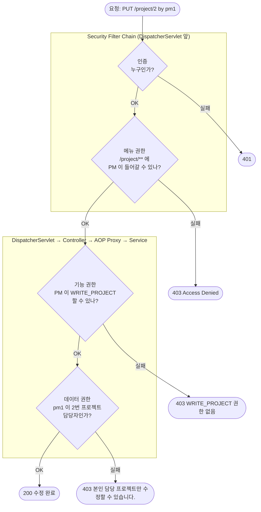
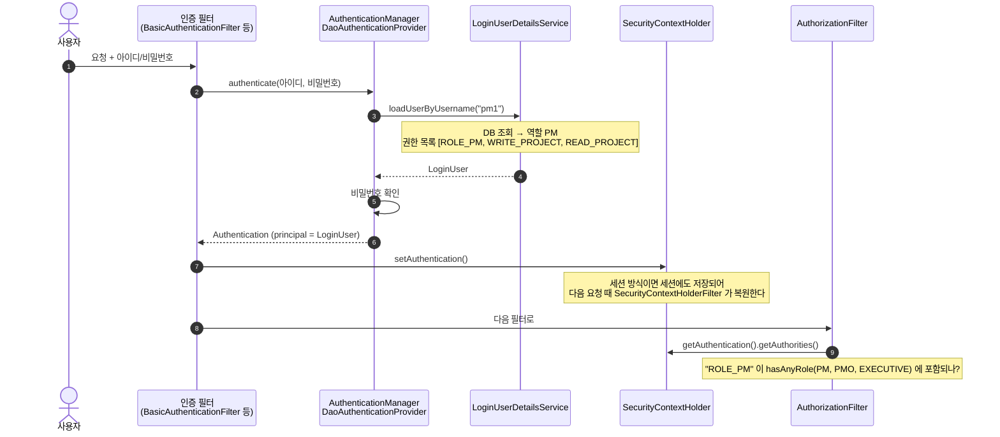
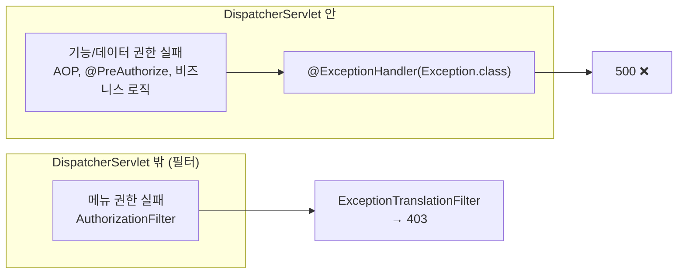

# Spring Security 인증 / 인가 — 메뉴 · 기능 · 데이터 권한

> 예제 코드: `src/main/java/com/study/security`
> 실행 가능한 문서(테스트): `src/test/java/com/study/security`
> 선행 문서: [01. Filter vs Interceptor vs AOP](01-filter-interceptor-aop.md)

---

## 0. 예제 시나리오

PM / PMO / 영업 / 경영진 네 역할이 있는 사내 프로젝트 관리 시스템.

| 계정 | 역할 | 비밀번호 |
|---|---|---|
| `pm1`, `pm2` | PM | `1234` |
| `pmo` | PMO | `1234` |
| `sales` | SALES (영업) | `1234` |
| `exec` | EXECUTIVE (경영진) | `1234` |

| 메뉴 | URL | 들어갈 수 있는 역할 | 안에 있는 기능 |
|---|---|---|---|
| 프로젝트 관리 | `/project/**` | PM, PMO, 경영진 | 조회(`READ_PROJECT`), 수정(`WRITE_PROJECT`) |
| 계약 관리 | `/contract/**` | 영업, 경영진 | 등록(`WRITE_CONTRACT`) |
| 예산 | `/budget/**` | PMO, 경영진 | 결재(`APPROVE_BUDGET`) |

---

## 1. 권한은 세 단계로 나눈다

| 권한 종류 | 무엇을 막나 | 예시 | 판단 근거 | 이 예제의 구현 위치 |
|---|---|---|---|---|
| **메뉴(화면) 권한** | 이 화면/URL 에 들어갈 수 있나 | 영업은 "프로젝트 관리" 메뉴 접근 불가 | **URL** | Security Filter (`SecurityConfig`) |
| **기능(행위) 권한** | 이 동작을 할 수 있나 | 경영진은 프로젝트를 볼 수는 있지만 수정은 불가 | **메서드 / 업무 동작** | AOP (`@RequireAuthority`, `@PreAuthorize`) 또는 비즈니스 로직 |
| **데이터 권한** | 이 데이터를 건드릴 수 있나 | PM 은 본인 담당 프로젝트만 수정 | **실제 데이터** | 비즈니스 로직 |

> 도구를 고르는 진짜 기준은 "무엇을 보고 판단하느냐"다.
> **URL 만 보면 되면 요청 단위(Filter/Interceptor), 메서드를 봐야 하면 AOP, 데이터를 조회해 봐야 하면 비즈니스 로직.**



위 요청(`pm1` 이 `pm2` 담당인 2번 프로젝트 수정)은 인증, 메뉴, 기능 권한을 모두 통과하지만 **데이터 권한에서 막힌다.**

---

## 2. 인증 — Role 은 어디서 꺼내오나

### 2.1 흐름

Role 은 **로그인할 때 DB 에서 한 번 꺼내서 `Authentication` 객체에 넣어 두고**, 이후 요청마다 그 객체를 다시 꺼내 쓴다.



### 2.2 Role 을 꺼내는 곳 — `UserDetailsService`

```java
@Override
public UserDetails loadUserByUsername(String username) {
    Account account = accounts.get(username);           // 실무에서는 DB 조회
    if (account == null) {
        throw new UsernameNotFoundException(username);
    }
    return new LoginUser(username, account.encodedPassword(), account.permission());
}
```

`LoginUser` 는 권한 목록에 **역할과 기능 권한을 함께** 넣는다.

```java
private static List<GrantedAuthority> authoritiesOf(Permission permission) {
    List<GrantedAuthority> authorities = new ArrayList<>();
    authorities.add(new SimpleGrantedAuthority("ROLE_" + permission.name()));   // 역할: "ROLE_PM"
    for (Authority authority : Authority.values()) {
        if (authority.isAllowed(permission)) {
            authorities.add(new SimpleGrantedAuthority(authority.name()));    // 기능 권한: "WRITE_PROJECT"
        }
    }
    return authorities;
}
```

> ⚠️ **`ROLE_` 접두사**: `hasRole("PM")` / `hasAnyRole("PM")` 은 내부적으로 `"ROLE_PM"` 과 비교한다.
> `hasAuthority("PM")` 은 접두사 없이 그대로 비교한다. 이걸 섞어 쓰면 "권한을 넣었는데 403" 이 난다.

### 2.3 저장된 사용자를 꺼내 쓰는 법

| 위치 | 방법 |
|---|---|
| 컨트롤러 | `@AuthenticationPrincipal LoginUser user` 파라미터 |
| 서비스, AOP 등 그 외 | `SecurityContextHolder.getContext().getAuthentication()` → 예제의 `CurrentUser.get()` |

### 2.4 JWT 를 쓴다면

세션 대신 토큰을 쓰면 **보관 위치만** 바뀐다.

- 로그인 시 역할을 **토큰의 claim** 에 넣어 클라이언트에 준다.
- 직접 만든 `JwtFilter` 가 매 요청마다 토큰을 검증하고, claim 에서 역할을 꺼내 `Authentication` 을 만들어 `SecurityContextHolder` 에 넣는다.

```java
String role = claims.get("role", String.class);   // "PM"
var auth = new UsernamePasswordAuthenticationToken(
        username, null, List.of(new SimpleGrantedAuthority("ROLE_" + role)));
SecurityContextHolder.getContext().setAuthentication(auth);
```

**커스텀 필터는 인증(SecurityContext 에 넣기)까지만 하고, 인가 판단은 `AuthorizationFilter` 에 맡기는 게 정석**이다.
인가 규칙이 `SecurityConfig` 한 곳에 모이고, 401/403 처리도 `ExceptionTranslationFilter` 가 일관되게 맡는다.

---

## 3. 메뉴(화면) 권한 — `SecurityConfig`

```java
.authorizeHttpRequests(auth -> auth
        .requestMatchers("/pipeline/**", "/error").permitAll()
        .requestMatchers("/project/**")
        .hasAnyRole(Permission.PM.name(), Permission.PMO.name(), Permission.EXECUTIVE.name())
        .requestMatchers("/contract/**")
        .hasAnyRole(Permission.SALES.name(), Permission.EXECUTIVE.name())
        .requestMatchers("/budget/**")
        .hasAnyRole(Permission.PMO.name(), Permission.EXECUTIVE.name())
        .anyRequest().authenticated());
```

- Spring Security 는 **인가도 필터에서 한다.** 위 규칙은 필터 체인의 마지막인 `AuthorizationFilter` 가 판단한다.
- 여기는 어노테이션이 아니라 일반 Java 코드라서 enum(`Permission.PM.name()`)을 그대로 쓸 수 있다.
- 규칙은 **위에서부터 처음 매칭되는 것**이 적용된다. 넓은 패턴(`anyRequest()`)은 항상 마지막에.

### 3.1 메뉴 권한을 구현하는 네 가지 방법

| 방법 | 언제 | 비고 |
|---|---|---|
| **① SecurityConfig 에 직접** (이 예제) | Spring Security 사용 + 메뉴가 적고 잘 안 바뀜 | 규칙이 한 파일에 다 보임. 변경 시 재배포 |
| **② Security + DB** (`AuthorizationManager`) | Spring Security 사용 + 관리자 화면에서 메뉴 권한을 바꿔야 함 | SI / 사내 시스템에서 흔함 |
| **③ Interceptor** | Spring Security 를 안 씀 | URL 매칭, 제외 경로, Model 에 메뉴 목록 담기가 편함 |
| ④ 직접 만든 일반 Filter | 비추천 | 아래 표의 일을 전부 직접 해야 함 |

**② Security + DB** — 규칙은 DB 에, `SecurityConfig` 는 연결만:

```java
@Component
public class MenuAuthorizationManager implements AuthorizationManager<RequestAuthorizationContext> {

    @Override
    public AuthorizationDecision check(Supplier<Authentication> authentication, RequestAuthorizationContext ctx) {
        String uri = ctx.getRequest().getRequestURI();
        return new AuthorizationDecision(menuService.canAccess(authentication.get(), uri));  // MENU, ROLE_MENU 테이블
    }
}

// SecurityConfig
.anyRequest().access(menuAuthorizationManager)
```

**③ Interceptor**:

```java
public boolean preHandle(HttpServletRequest req, HttpServletResponse res, Object handler) throws IOException {
    Menu menu = menuService.findByUrl(req.getRequestURI());
    if (menu != null && !menuService.canAccess(currentUserRole(), menu)) {
        res.sendError(HttpServletResponse.SC_FORBIDDEN);
        return false;
    }
    return true;
}
```

**④ 일반 Filter 로 하면 직접 챙겨야 하는 것들** (Interceptor / Security 는 프레임워크가 해 줌):

| 직접 해야 하는 일 | 이유 |
|---|---|
| URL 패턴 매칭 (`PathPattern`, `AntPathMatcher`) | 서블릿 URL 패턴은 `/project/*` 수준만 지원. `/**` 같은 스프링 문법 없음 |
| 403 응답 작성 | 필터는 `@ExceptionHandler` 범위 밖 |
| 제외 경로 관리 (`shouldNotFilter`) | Interceptor 의 `excludePathPatterns` 같은 기능이 없음 |
| 필터 순서 (`setOrder`) | 로그인 필터보다 먼저 실행되면 사용자 정보가 없음 |

> ⚠️ **메뉴를 숨기는 것만으로는 막은 게 아니다.** 화면에서 메뉴를 안 보여줘도 URL 을 직접 입력하거나 API 를 직접 호출할 수 있다.
> 서버에서 URL 단위로 반드시 차단해야 한다.

---

## 4. 기능(행위) 권한 — `Authority` enum + 세 가지 체크 방식

### 4.1 역할과 기능 권한을 분리한 enum

```java
public enum Authority {
    WRITE_PROJECT(Permission.PM, Permission.PMO),
    READ_PROJECT(Permission.PM, Permission.PMO, Permission.EXECUTIVE),
    WRITE_CONTRACT(Permission.SALES),
    READ_CONTRACT(Permission.SALES, Permission.EXECUTIVE),
    APPROVE_BUDGET(Permission.EXECUTIVE);

    private final Set<Permission> allowed;

    Authority(Permission... allowed) {
        this.allowed = EnumSet.copyOf(Arrays.asList(allowed));
    }

    public boolean isAllowed(Permission role) {
        return allowed.contains(role);
    }
}
```

"이 기능은 누가 쓸 수 있나"가 표처럼 한 파일에 모인다.

| 요구사항 | enum 만으로 가능? |
|---|---|
| 영업에게 프로젝트 조회 권한 추가 | ✅ `READ_PROJECT(..., Permission.SALES)` |
| PM 은 **본인 담당 프로젝트만** 수정 | ❌ 데이터를 봐야 함 → 비즈니스 로직 (5장) |
| 1억 이상 결재는 경영진만 | ❌ 요청 값을 봐야 함 → 비즈니스 로직 |
| 특정 개인에게만 예외 허용 | ❌ 개인 단위 → DB 관리 필요 |
| 재배포 없이 운영 중 변경 | ❌ 코드라서 재배포 필요 → DB 관리 필요 |

### 4.2 같은 enum 을 체크하는 세 가지 방식

이 예제는 세 방식을 각각 다른 기능에 적용했다.

**① 비즈니스 로직에서 직접** — `ContractService` (계약 등록)

```java
public String write(String title, LoginUser user) {
    if (!Authority.WRITE_CONTRACT.isAllowed(user.getPermission())) {
        throw new AccessDeniedException(Authority.WRITE_CONTRACT + " 권한 없음");
    }
    return "계약 등록: " + title;
}
```

**② `@PreAuthorize`** — `BudgetService` (예산 결재)

```java
@PreAuthorize("hasAuthority('APPROVE_BUDGET')")
public String approve(Long id) {
    return "예산 결재 완료: " + id;
}
```

**③ 커스텀 어노테이션 + 직접 만든 AOP** — `ProjectService` (프로젝트 조회/수정)

```java
@Target(ElementType.METHOD)
@Retention(RetentionPolicy.RUNTIME)
public @interface RequireAuthority {
    Authority value();                       // 어노테이션 속성 타입으로 enum 을 쓸 수 있다
}

@Aspect
@Component
public class AuthorityAspect {
    @Before("@annotation(requireAuthority)")
    public void check(RequireAuthority requireAuthority) {
        Authority authority = requireAuthority.value();
        LoginUser user = CurrentUser.get();
        if (!authority.isAllowed(user.getPermission())) {
            throw new AccessDeniedException(authority + " 권한 없음");
        }
    }
}

@RequireAuthority(Authority.WRITE_PROJECT)
public Project rename(Long id, String name, LoginUser user) { ... }
```

### 4.3 비교

| | ① 비즈니스 로직 | ② `@PreAuthorize` | ③ 커스텀 AOP |
|---|---|---|---|
| 코드 위치 | 메서드 안 `if` 문 | 메서드 위 어노테이션 | 메서드 위 어노테이션 |
| enum 타입 안전성 | ✅ | ❌ 문자열 `'APPROVE_BUDGET'` (오타가 런타임에야 드러남) | ✅ `Authority.WRITE_PROJECT` |
| 핵심 로직과 분리 | ❌ 섞임 | ✅ | ✅ |
| 권한에 따라 로직 분기 | ✅ 자유로움 | ❌ 실행 여부만 결정 | ❌ 실행 여부만 결정 |
| 구현량 | 없음 | 없음 (Security 제공) | 어노테이션 + Aspect 직접 작성 |
| 파라미터/반환값 활용 | ✅ | ✅ SpEL (`#id`, `returnObject`) | 직접 구현해야 함 |

**정리**
- 이런 `Authority` enum 이 있는 프로젝트라면 **③ 커스텀 AOP** 가 가장 잘 맞는다. enum 의 장점을 살리면서 로직과 분리된다.
- enum 없이 Spring Security 의 권한 문자열만 쓴다면 **② `@PreAuthorize`** 가 가장 간단하다.
- **권한에 따라 결과가 달라지는 경우**(경영진이면 금액까지 보여주고 아니면 가림)만 **① 비즈니스 로직**에서 체크한다.

### 4.4 `@PreAuthorize` 의 정체 — Spring Security 가 미리 만들어 둔 AOP

③ 에서 직접 만든 `AuthorityAspect` 와 같은 일을 Spring Security 가 미리 만들어 둔 것이다.
`@EnableMethodSecurity` 를 붙이면 `AuthorizationManagerBeforeMethodInterceptor` 가 등록되어 프록시로 메서드를 감싼다.

```
Controller → [프록시] @PreAuthorize 의 SpEL 평가 → 통과하면 → BudgetService.approve()
                       └ 실패하면 AccessDeniedException → 403
```

| 어노테이션 | 시점 | 예시 |
|---|---|---|
| `@PreAuthorize` | 메서드 실행 **전** | `@PreAuthorize("hasRole('ADMIN')")` |
| `@PostAuthorize` | 메서드 실행 **후** (반환값 확인) | `@PostAuthorize("returnObject.ownerId == authentication.name")` |
| `@PreFilter` / `@PostFilter` | 컬렉션 파라미터/반환값 필터링 | `@PostFilter("filterObject.ownerId == authentication.name")` |
| `@Secured`, `@RolesAllowed` | 실행 전 (역할만, SpEL 없음) | `@Secured("ROLE_ADMIN")` |

SpEL 에서 스프링 빈을 호출해 복잡한 판단을 위임할 수도 있다.

```java
@PreAuthorize("@projectAuthorizer.isManager(#id, authentication)")
public void delete(Long id) { ... }
```

> ⚠️ `@PostAuthorize` 는 메서드가 **이미 실행된 뒤**에 검사한다. 수정/삭제처럼 부작용이 있는 메서드에 쓰면 안 된다.

---

## 5. 데이터 권한 — 비즈니스 로직

```java
@RequireAuthority(Authority.WRITE_PROJECT)                // 기능 권한 (AOP)
public Project rename(Long id, String name, LoginUser user) {
    Project project = projectRepository.findById(id).orElseThrow(...);

    // 데이터 권한: PM 은 본인 담당 프로젝트만 (PMO 는 전체 가능)
    if (user.is(Permission.PM) && !project.isManagedBy(user.getUsername())) {
        throw new AccessDeniedException("본인 담당 프로젝트만 수정할 수 있습니다.");
    }
    return projectRepository.save(project.rename(name));
}
```

데이터를 조회해 봐야 판단할 수 있으니 비즈니스 로직에 둔다.
`@PreAuthorize("@projectAuthorizer.isManager(#id, authentication)")` 처럼 빈에 위임해서 어노테이션으로 올리는 방법도 있지만,
데이터를 두 번 조회하게 되는 경우가 많아 보통은 로직 안에서 체크한다.

---

## 6. 테스트로 확인한 결과

`SecurityLayersTest` — 403 응답의 `message` 로 어느 단계에서 막혔는지 구분된다.

| 요청 | 계정 | 결과 | 막힌 단계 | message |
|---|---|---|---|---|
| `GET /project/1` | (없음) | **401** | 인증 | |
| `GET /project/1` | pm1 / 틀린 비번 | **401** | 인증 | |
| `GET /project/1` | sales | **403** | 메뉴 | `Access Denied` |
| `POST /contract` | pm1 | **403** | 메뉴 | `Access Denied` |
| `POST /budget/1/approve` | sales | **403** | 메뉴 | `Access Denied` |
| `GET /project/1` | exec | 200 | | |
| `PUT /project/1` | exec | **403** | 기능 ③ 커스텀 AOP | `WRITE_PROJECT 권한 없음` |
| `POST /contract` | sales | 200 | | |
| `POST /contract` | exec | **403** | 기능 ① 비즈니스 로직 | `WRITE_CONTRACT 권한 없음` |
| `POST /budget/1/approve` | exec | 200 | | |
| `POST /budget/1/approve` | pmo | **403** | 기능 ② `@PreAuthorize` | `Access Denied` |
| `PUT /project/1` | pm1 | 200 | | |
| `PUT /project/2` | pm1 | **403** | 데이터 | `본인 담당 프로젝트만 수정할 수 있습니다.` |
| `PUT /project/2` | pmo | 200 | | |

경영진(`exec`)은 프로젝트 메뉴에 들어가 **조회는 되지만 수정은 안 되고**, PMO 는 예산 메뉴에 들어가지만 **결재는 못 한다.**
메뉴 권한과 기능 권한이 따로 필요한 이유다.

---

## 7. 함정 모음 (모두 테스트로 확인됨)

### 7.1 `@PreAuthorize` 도 내부 호출에는 적용되지 않는다 → 권한 우회

`MethodSecuritySelfInvocationTest`

```java
@PreAuthorize("hasAuthority('APPROVE_BUDGET')")
public String approve(Long id) { ... }

public List<String> approveAll(List<Long> ids) {
    return ids.stream().map(this::approve).toList();   // this.approve() — 프록시를 안 거침!
}
```

- PMO 가 `approve()` 를 직접 호출 → `AccessDeniedException`
- PMO 가 `approveAll()` 을 호출 → **결재 성공** (권한 우회)

01 문서의 self-invocation 문제가 보안에서는 **보안 구멍**이 된다. 직접 만든 `@RequireAuthority` 도 마찬가지다.
private 메서드에도 적용되지 않는다.

### 7.2 전역 `@ExceptionHandler(Exception.class)` 가 403 을 500 으로 바꾼다

`ExceptionHandlerPitfallTest`



| 권한 예외가 난 곳 | 전역 `@ExceptionHandler(Exception.class)` 있을 때 |
|---|---|
| 메뉴 권한 (필터) | **403** — DispatcherServlet 밖이라 `@ExceptionHandler` 가 못 잡음 |
| 기능 권한 (AOP, `@PreAuthorize`) | **500** ❌ — `@ExceptionHandler` 가 먼저 잡음 |

해결: 전역 핸들러에서 `AccessDeniedException` 은 다시 던지거나, 403 으로 따로 처리한다. (`ExceptionHandlerPitfallFixTest`)
같은 advice 안에서는 더 구체적인 예외 타입의 핸들러가 우선 선택된다.

```java
@ExceptionHandler(AccessDeniedException.class)
public void rethrow(AccessDeniedException e) {
    throw e;   // Security 의 ExceptionTranslationFilter 가 처리하도록 넘긴다
}
```

### 7.3 필터에서 난 예외는 `@ExceptionHandler` 가 못 잡는다

7.2 의 반대 방향. 인증 실패(401)와 메뉴 권한 실패(403)의 응답 형식을 바꾸려면 `@ExceptionHandler` 가 아니라
`AuthenticationEntryPoint`(401), `AccessDeniedHandler`(403)를 설정해야 한다. → 예제의 `JsonAccessDeniedHandler`

### 7.4 `ROLE_` 접두사

`hasRole("PM")` 은 `"ROLE_PM"` 과, `hasAuthority("PM")` 은 `"PM"` 과 비교한다. (2.2 참고)

---

## 8. 최종 정리

```
Security Filter  : 인증 — 누구인가?                          → UserDetailsService, JwtFilter
                   메뉴 권한 — 이 화면/URL 에 들어갈 수 있나?    → SecurityConfig (또는 DB + AuthorizationManager)
AOP              : 기능 권한 — 이 동작을 할 수 있나?             → @RequireAuthority(Authority.X) / @PreAuthorize
비즈니스 로직      : 데이터 권한 — 이 데이터를 건드릴 수 있나?     → if (본인 담당인지)
```

**"화면 권한은 요청 단위로, 기능 권한은 메서드 단위로, 데이터 권한은 로직 안에서."**

---

## 9. 직접 실행해보기

```bash
./gradlew bootRun --args='--server.port=18080'
```

```bash
curl -i localhost:18080/project/1                                   # 401
curl -i -u sales:1234 localhost:18080/project/1                     # 403 메뉴
curl -i -u exec:1234  localhost:18080/project/1                     # 200
curl -i -u exec:1234  -X PUT "localhost:18080/project/1?name=new"   # 403 기능 (WRITE_PROJECT)
curl -i -u pm1:1234   -X PUT "localhost:18080/project/2?name=new"   # 403 데이터 (본인 담당 아님)
curl -i -u pm1:1234   -X PUT "localhost:18080/project/1?name=new"   # 200
curl -i -u pmo:1234   -X POST localhost:18080/budget/1/approve      # 403 기능 (@PreAuthorize)
curl -i -u exec:1234  -X POST localhost:18080/budget/1/approve      # 200
```

```bash
./gradlew test
```

---

## 10. 더 알아볼 것

- `RoleHierarchy` — "경영진은 PMO 의 권한을 모두 가진다" 같은 역할 계층 (단, 영업과 PM 처럼 상하가 아닌 역할을 계층에 넣으면 권한이 새어 나간다)
- 메뉴/기능 권한을 DB 로 관리하고 캐시하기 (`MENU`, `ROLE_MENU` 테이블 + `AuthorizationManager`)
- JWT 인증 필터 구현과 토큰 재발급(Refresh Token)
- `@AuthorizeReturnObject`, `@HandleAuthorizationDenied` — Spring Security 6.3+ 의 메서드 보안 확장 기능
